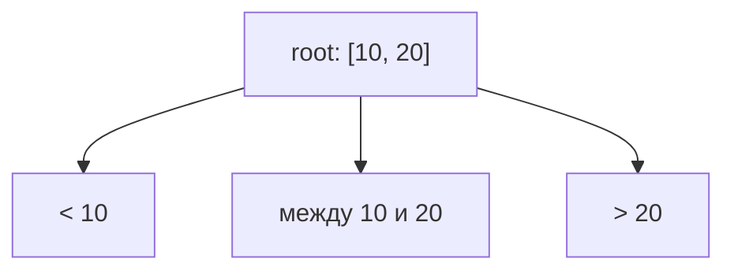
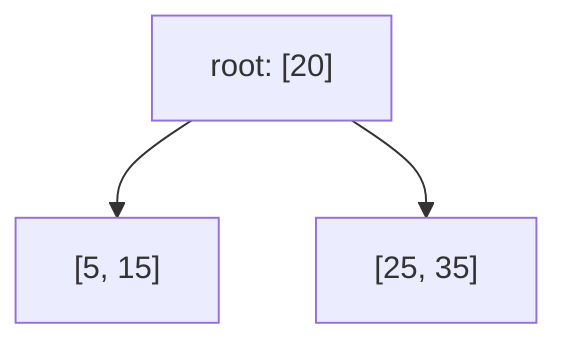

# B-деревья: обзор (концептуально)

Этот документ — **концептуальный**: B-деревья в библиотеке `algorithms/` не
реализованы, визуализации у темы нет. Материал — теоретическая вводная к
модулю квиза: он объясняет модель структуры и её инварианты, а не описание
существующего кода. Наличие раздела в документации, как и для других тем с
пометкой «концептуально» ([bst.md](bst.md)), не свидетельствует о
реализации.

B-дерево — обобщение идеи BST: это тоже упорядоченное дерево поиска, где
поиск ведётся спуском от корня по ключам, но **в одном узле хранится
несколько ключей**, а не один, и у узла может быть больше двух потомков.
Именно этим B-дерево отличается от бинарного дерева поиска, у которого в
узле ровно один ключ и не более двух потомков.

### Узел: упорядоченные ключи и диапазоны потомков

Узел B-дерева хранит несколько ключей в отсортированном порядке. Ключи
узла — **разделители**: каждый из них отделяет диапазон значений одного
потомка от диапазонов соседних. Пока спуск идёт через **внутренний
узел**, действует связь: если в узле `k` ключей, у него ровно `k + 1`
потомок:

- первый потомок хранит ключи, меньшие первого ключа узла;
- каждый промежуточный потомок — ключи строго между двумя соседними
  ключами узла;
- последний потомок — ключи, большие последнего ключа узла.

У листа потомков нет, поэтому правило «`k` ключей — `k + 1` потомок» —
не универсальное свойство любого узла, а описание именно внутренних
узлов: диапазоны задают, куда продолжается спуск, а лист спуск
завершает.

Пример: корень `[10, 20]` с тремя потомками.

Ключ `15` лежит строго между `10` и `20`, поэтому его место — средний
потомок; ключ `5` — в левом, ключ `30` — в правом. Требование того же
порядка, что в BST («всё слева меньше, всё справа больше»), теперь
выражено диапазонами: поддерево потомка содержит только ключи своего
диапазона.

Вместимость узла — вопрос **конвенции** (обычно её выражают параметром
структуры, а не универсальным числом): пока не выбрана конкретная
конвенция, никаких общих численных порогов «сколько ключей максимум» у
B-дерева нет. Пример выше численную вместимость не задаёт — в нём узлы
показаны лишь как разделители диапазонов; единственный пример с явно
оговорённой конвенцией — ниже, в разделе о расщеплении узла.

### Одинаковая глубина листьев и поиск по одному пути

Все листья B-дерева лежат **на одной глубине** — это не следствие удачной
случайной вставки, а инвариант структуры, поддерживаемый способом её
роста (см. раздел о расщеплении ниже). Поэтому «сбалансированность» здесь —
не отдельная процедура поверх операций, как в BST, а часть определения.

Поиск ключа идёт по **одному пути** от корня до листа, как в BST, но
внутри узла шаг другой: сравниваем ключ с несколькими ключами узла и
выбираем один диапазон — то есть ровно одного потомка для продолжения
спуска. Поиск в одном узле перебирает его немногочисленные ключи, а не
поддеревья; остальные потомки того же узла (соседние по диапазону) и их
поддеревья на каждом шаге отсекаются целиком.

### Вставка: расщепление (split) заполненного узла

Вставка начинается как поиск: спуск по одному пути до листа, в диапазон
которого попадает новый ключ. Если в листе есть место, ключ просто
добавляется в отсортированный порядок узла.

Интересный случай — узел **заполнен** по выбранной конвенции. Тогда узел
**расщепляется** (split):

1. переполнившийся узел делится на два узла поменьше;
2. ключ-разделитель из его середины **продвигается вверх** — переходит в
   родительский узел и становится границей между двумя новыми узлами;
3. если родитель от этого тоже переполнился, расщепление повторяется
   уже для него — продвижение ключа может продолжаться вверх по одному
   пути;
4. если переполнение дошло до корня, старый корень расщепляется и
   продвинутый ключ становится **новым корнем** — высота дерева
   увеличивается на 1.

Пример. Конвенция примера: узел вмещает не более 4 ключей. Корень-лист
`[5, 15, 25, 35]` заполнен; вставляем `20`. Пять ключей
`5, 15, 20, 25, 35` делятся так: средний ключ `20` продвигается и
становится новым корнем, остальные образуют два листа-потомка
`[5, 15]` и `[25, 35]`:

Из этого способа роста и следует инвариант из предыдущего раздела:
высота растёт **только** при расщеплении (split) корня, и тогда новый
уровень появляется сразу у всех листьев. Варианта два: если корень был
листом (пример выше), он сам делится на два листа-потомка нового корня;
если корень был внутренним узлом, его старые поддеревья становятся
поддеревьями нового корня. В обоих случаях существующие листья
оказываются на один уровень глубже, причём все одинаково: расщепление
любого узла ниже корня меняет содержимое существующих уровней, но не их
число, поэтому глубина всех листьев всегда одинаковая.

### Почему высокий branching factor важен: страницы

B-деревья применяют там, где узлы хранятся не в оперативной памяти, а на
диске, и чтение идёт **страницами**: один узел кладут на одну страницу,
и чтение узла — это одна сравнительно дорогая операция ввода-вывода.
Стоимость поиска тогда определяется не числом ключей, а числом
прочитанных узлов, то есть длиной пути от корня до листа — высотой
дерева.

Ветвление узла (branching factor) — число его потомков. Чем больше
ключей умещается в одном узле, тем больше потомков у узла и тем **меньше
высота** дерева при том же числе ключей: с каждым уровнем спуск
отсекает не половину остатка, как в бинарном дереве, а всё кроме одного
из `k + 1` диапазонов внутреннего узла. Высокий branching factor даёт
низкое дерево, а низкое дерево — малое число страниц, которые нужно
прочитать при поиске: рост высоты логарифмический по основанию, растущему
с вместимостью узла. Именно поэтому ключи в узле перебираются «внутри»
уже прочитанной страницы — дёшево, — а дорогие чтения страниц происходят
только по пути спуска.

Что остаётся за рамками этого материала: удаление ключей и обратная к
расщеплению операция слияния узлов, вариант B+ tree, а также внутреннее
устройство конкретных СУБД — это темы вне объёма модуля.
