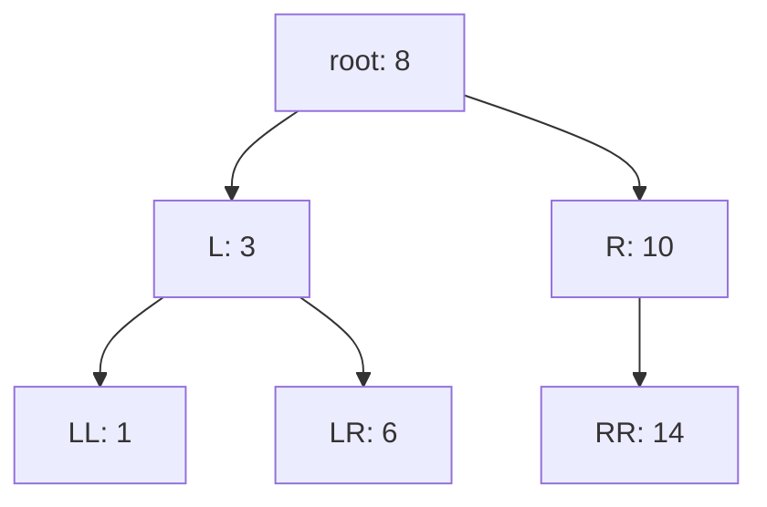

# Бинарное дерево поиска: вставка, поиск и удаление

Реализация: `algorithms/trees/` (`bst.go`, `bst_events.go`) поверх общей
модели `Node` из обходов; quiet mode и режим наблюдения дают одно и то же
поведение (ADR-0001).

## Модель и инвариант

BST — бинарное дерево со **строгим порядком**: у каждого узла все значения
левого поддерева меньше его значения, все значения правого — строго больше.
Значение узла и есть **ключ**; ключи уникальны — повторная вставка
существующего ключа не меняет дерево. Пустое дерево — корень `nil`.



Каждый узел задаётся путём от корня — строкой из букв `L` и `R` (корень —
пустой путь, идентификатор `root`, функция `NodeID`): та же система
координат, что у обходов. Строгий порядок проверяется на **всём** поддереве,
а не только на непосредственных потомках: `6` в примере меньше `8`, хотя
стоит в правом поддереве узла `3`.

## Вставка

Спуск от корня: ключ меньше — влево, больше — вправо; новый узел встаёт
в первое пустое место на пути. Повторная вставка существующего ключа
останавливается на найденном узле и **не меняет дерево** — операция
сообщает об этом признаком: `Insert` возвращает корень (возможно новый —
у пустого дерева) и признак, выполнена ли вставка.

```
Insert(root, 5):  пустое дерево → узел 5 становится корнем
Insert(root, 3):  3 < 5 → влево → пустое место → узел L: 3
Insert(root, 7):  7 > 5 → вправо → пустое место → узел R: 7
Insert(root, 5):  5 = 5 → дубликат: дерево не изменилось, inserted = false
```

## Поиск

Тот же спуск: каждое сравнение отсекает одну из двух ветвей — поддерево,
где ключа заведомо нет. Отсечённая часть не обязана быть «половиной»
остатка: у сбалансированного дерева она близка к половине, у
несбалансированного может быть любой — от пустого поддерева до почти
всего дерева. `Search` возвращает найденный узел и признак находки; промах
(спуск дошёл до пустого места, ключа нет) и пустое дерево — определённые
результаты, а не ошибки: `(nil, false)`.

## Удаление

`Delete` находит узел спуском и удаляет по трём случаям, возвращая новый
корень и признак, выполнено ли удаление:

1. **Лист** — на место узла встаёт пустота;
2. **один потомок** — на место узла встаёт его единственное поддерево;
3. **два потомка** — значение узла заменяется значением
   **inorder-successor** — минимума правого поддерева, — после чего сам
   узел-преемник вырезается из правого поддерева повторным рекурсивным
   `remove`: тот заново спускается от корня правого поддерева по пути к
   преемнику и там выполняет случай 1 или 2 (у преемника нет левого
   потомка).

Почему преемник именно оттуда: inorder-successor — узел со следующим по
величине ключом; минимум правого поддерева больше удаляемого узла и меньше
всех остальных узлов этого поддерева, поэтому после замены инвариант
сохраняется, а его позиция (самый левый узел правого поддерева) легко
находится спуском влево.

Удаление корня — те же три случая: одноузловое дерево пустеет (новый корень
`nil`), корень с одним потомком замещается потомком, корень с двумя —
преемником. Удаление отсутствующего ключа не меняет дерево: `deleted=false`.

## Сложность

Вставка и поиск идут по одному пути от корня: время O(h) — высота дерева.
Худший случай — перекошенное дерево (вставка отсортированной
последовательности): h = n, операции вырождаются в O(n). Сбалансированность
BST в библиотеке не гарантируется (вне объёма модуля).

Удаление листа или узла с одним потомком — тот же один спуск. Удаление
узла с двумя потомками — три прохода по путям дерева: `remove` спускается
до удаляемого узла, поиск минимума доходит до преемника в правом
поддереве, затем повторный рекурсивный `remove` от корня правого
поддерева заново проходит сравнениями путь до узла-преемника и вырезает
его (у преемника нет левого потомка — срабатывает случай 1 или 2).
Каждый проход идёт по одному пути и стоит O(h), поэтому общая граница
операции — O(h).

## Quiet mode и события

Quiet-версии (`Insert`, `Search`, `Delete`) — обычные функции: принимают
корень, возвращают новый корень и признак исхода. Режим наблюдения —
`InsertWithEmitter`, `SearchWithEmitter`, `DeleteWithEmitter` с тем же
результатом (ADR-0001); события:

| Событие | Шаг |
|---------|-----|
| `BSTCompare{Path, Key, Value, Branch}` | сравнение ключа с узлом; `Branch` — выбранная ветвь: `"L"`, `"R"`, `""` — равенство |
| `BSTInserted{Path, Key}` | новый узел создан в пустом месте `Path` |
| `BSTDuplicate{Path, Key}` | повторная вставка: дерево не изменилось |
| `BSTFound{Path, Key}` | ключ найден в узле `Path` |
| `BSTNotFound{Path, Key}` | промах: место, где ключ был бы |
| `BSTMinStep{Path, Value}` | поиск минимума правого поддерева стоит на узле `Path` |
| `BSTSuccessor{Path, SuccessorPath, Value}` | у узла `Path` два потомка: преемник — `SuccessorPath` со значением `Value` |
| `BSTRemoved{Path, Key}` | узел удалён: на место встал потомок или пустота |

Пример — удаление корня `10` из дерева 10, 5, 20, 15, 30 (преемник — 15):

```
BSTCompare{Path: "",  Key: 10, Value: 10, Branch: ""}  — ключ найден, два потомка
BSTMinStep{Path: "R",  Value: 20}                       — поиск минимума
BSTMinStep{Path: "RL", Value: 15}                       — преемник — 15
BSTSuccessor{Path: "", SuccessorPath: "RL", Value: 15}  — 15 переходит корню
BSTCompare{Path: "R",  Key: 15, Value: 20, Branch: "L"} — повторный спуск remove к преемнику
BSTCompare{Path: "RL", Key: 15, Value: 15, Branch: ""}
BSTRemoved{Path: "RL", Key: 15}                         — преемник вырезан
```

По событиям восстанавливаются и сравнения с переходами по ветвям, и исход
операции, и структурные изменения; пути узлов — те же идентификаторы, что
у снимков дерева (NodeID).
