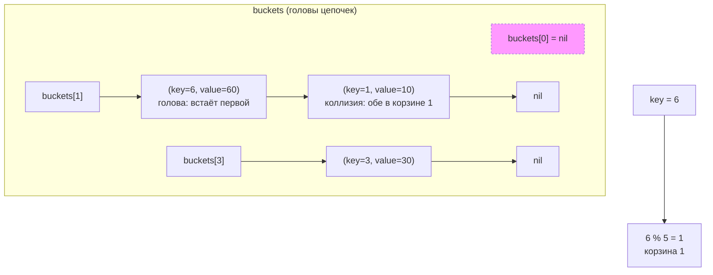
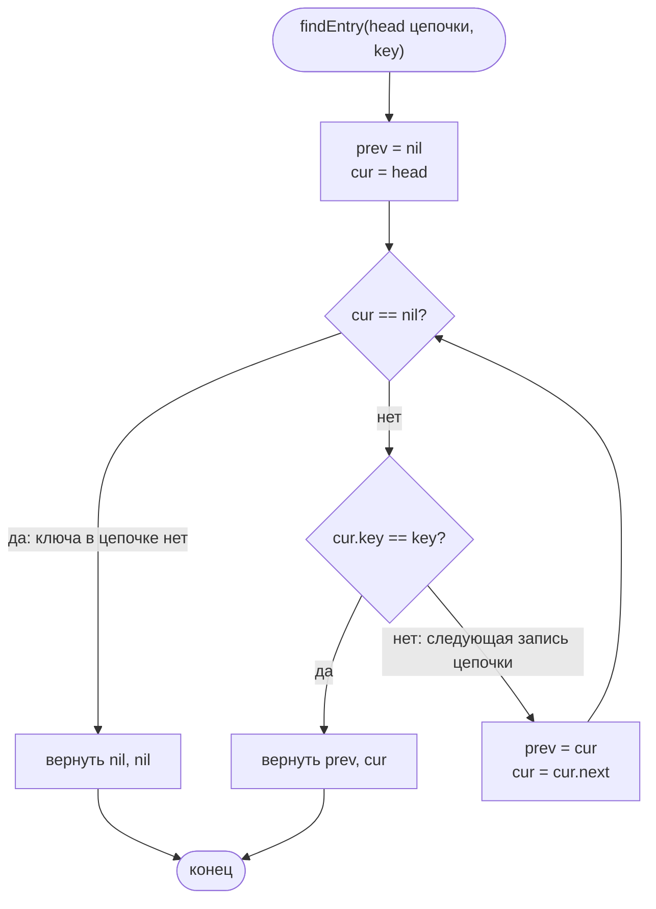
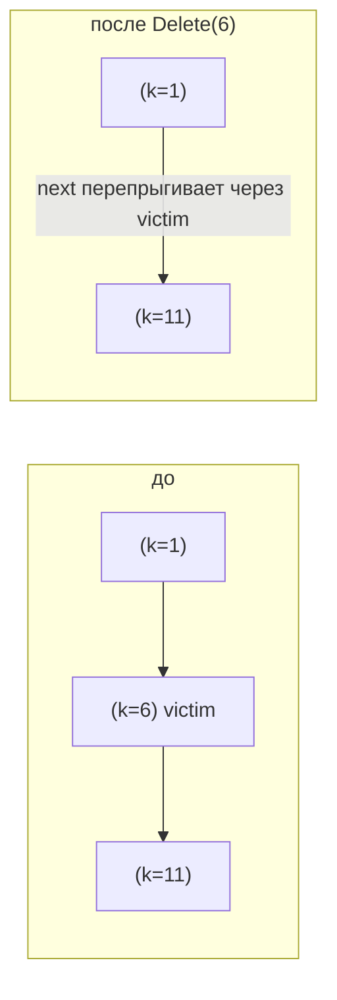

# Хеш-таблица

Реализация: `algorithms/structures/` (`HashTable`). Учебная таблица
с фиксированным числом корзин и разрешением коллизий методом **цепочек**:
каждая корзина хранит односвязную цепочку записей «ключ — значение»
(`hashEntry`). Таблица не растёт и не делает rehash — цена коллизий видна
прямо по длине цепочки.

## Представление

Целочисленный ключ попадает в корзину: `bucketOf(key) = key % число корзин`
(у Go знак остатка повторяет знак ключа, поэтому отрицательный остаток
нормализуется прибавлением числа корзин). Пример с 5 корзинами:

Ключи 1 и 6 коллидируют: при 5 корзинах их остатки одинаковы (1). Новая запись
встаёт **во главу** цепочки — вставка O(1) от неё самой, соседние записи
не сдвигаются (именно поэтому в примере ключ 6 стоит раньше ключа 1).

## Обход цепочки при коллизиях

Поиск по цепочке (`findEntry` — общий помощник `Get`, `Put`, `Delete`)
— операция, где обработка коллизий важна для понимания цены: идём от головы
корзины запись за записью по ключу. Это единственный обход в структуре,
его цена — длина цепочки, а не число корзин.

## Операции

| Операция | Как работает | Цена |
|----------|--------------|------|
| `Put(key, value)` | ключ уже в цепочке — переписывается значение (`Len` тот же); иначе новая запись встаёт во главу корзины, `size++` | O(длина цепочки), вставка в голову O(1) |
| `Get(key)` | `findEntry` по своей корзине; промах — не ошибка, а `(0, false)` | O(длина цепочки) |
| `Delete(key)` | `findEntry`; связи перепрыгивают через удаляемую запись (`prev.next = victim.next`), головной случай — корзина смотрит на `victim.next`; промах — `false` | O(длина цепочки) |
| `Len()` | инкрементный счётчик `size` | O(1), обхода нет |

Удаление из середины цепочки:

Особые случаи:

- `NewHashTable` с `nBuckets ≤ 0` — ошибка `ErrHashTableInvalidBuckets`
  (деление ключа на ноль непригодно), а не паника.
- Неизменность числа корзин делает хеширование **детерминированным**: при
  5 корзинах ключи 1, 6 и 11 всегда попадают в корзину 1 — это полезно
  для воспроизводимых примеров и визуализации.
- Отдельный тип `hashEntry` (а не переиспользование `node` списка): запись
  обязана нести и ключ, и значение — две разные абстракции.
