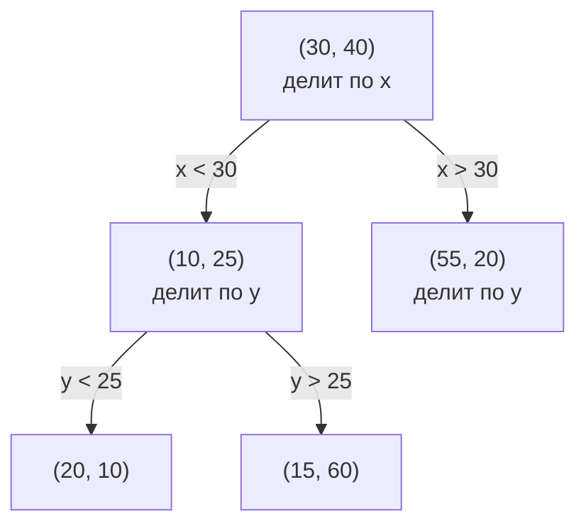
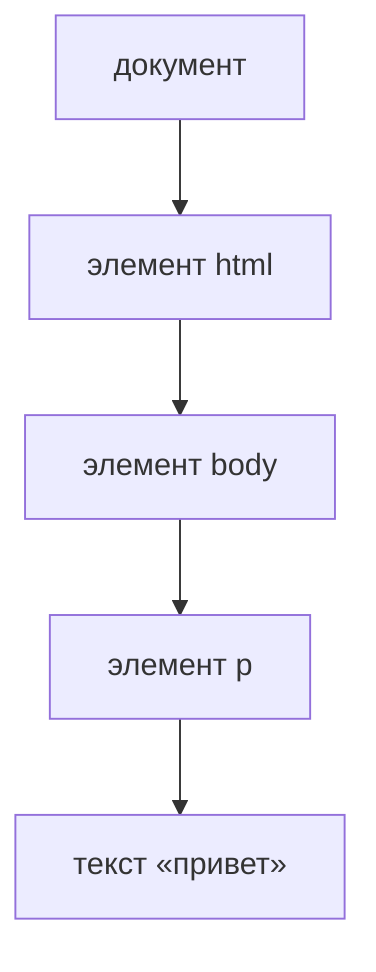
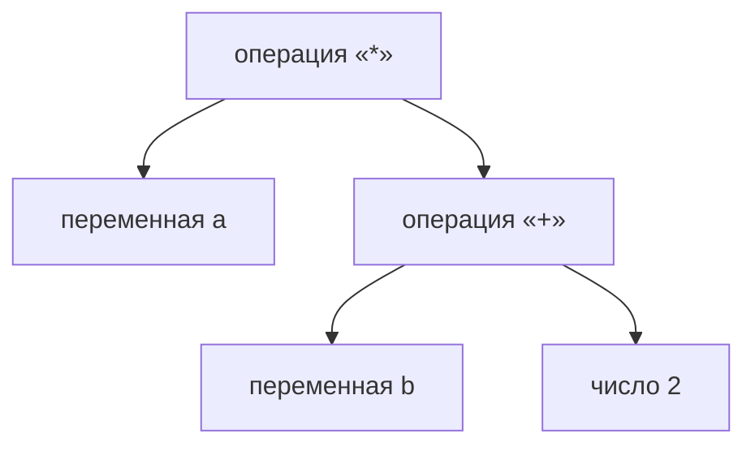

# KD-деревья, DOM и AST: обзор (концептуально)

Этот документ — **концептуальный**: KD-деревья, DOM и AST в библиотеке
`algorithms/` не реализованы, визуализации у тем нет. Материал — теоретическая
вводная к модулю квиза, по образцу [обзора B-деревьев](b-trees.md): наличие
раздела в документации, как и для других тем с пометкой «концептуально»
([bst.md](bst.md)), не свидетельствует о реализации.

Три структуры собраны в один модуль не потому, что они похожи по устройству, а
потому, что все три — **деревья**: у каждой есть узлы, отношение «родитель —
потомок» и поддеревья. Это единственное, что у них общее. Назначение, смысл
узлов и тип ветвления различаются, поэтому аналогия «это всё деревья» не
переносит операции и инварианты одной структуры на другую.

## KD-дерево: разбиение многомерного пространства

KD-дерево (k-dimensional tree) хранит **точки в k-мерном пространстве** — не
отдельные числа-ключи, как BST, а точки с несколькими координатами. Каждый узел
содержит точку и **делит область плоскостью по одной координате**: точки с
меньшим значением этой координаты уходят в левое поддерево, с большим — в
правое. Разделяющая плоскость перпендикулярна выбранной оси, поэтому спуск по
дереву — это последовательное разбиение исходной области на всё меньшие части.

Пример: точки на плоскости (k = 2) при конвенции «цикл по осям по глубине»
(она оговорена ниже). Корень делит пространство по первой координате (x); его
потомки — весь следующий уровень — по второй (y); уровень ниже них снова
делил бы по x, но потомки листьев на диаграмме не нарисованы, поэтому этот
уровень не показан. Подпись «делит по …» стоит только у узлов, чьи потомки
нарисованы, — это условие рисунка, а не свойство листа: точка-лист хранит
координату так же, как остальные узлы, и у узла с потомками она и есть
координата-разделитель:

Точка `(20, 10)` при поиске спустится влево от корня (`x = 20 < 30`), а дальше
выбор между потомками узла `(10, 25)` определяется уже второй координатой:
`y = 10 < 25`, поэтому спуск продолжается в левое поддерево узла `(10, 25)` —
к сохранённой точке `(20, 10)`.

**Какая координата-разделитель выбирается в узле — часть конвенции
реализации.** Типичный пример — цикл по осям по глубине: узел на одном уровне
делит по первой координате, следующий уровень — по второй и так далее, с
возвратом к первой оси после последней. Это пример, а не обязательное свойство
всех вариантов: существуют и другие стратегии выбора оси, поэтому конкретную
стратегию следует оговаривать, а не приписывать KD-дереву как таковому.

### Поиск ближайшего соседа и отсечение областей

Задача ближайшего соседа: по запросу-точке найти сохранённую точку с
наименьшим расстоянием до неё. Идея поиска:

1. Спуск по дереву в область, где лежит запрос, даёт **первый кандидат** на
   ближайшую точку и начальное значение текущего лучшего расстояния.
2. Настоящий ближайший сосед может лежать и в **соседней области** — через
   разделяющую плоскость. Соседняя область проверяется выборочно: если
   расстояние от запроса до её разделяющей плоскости **меньше** текущего
   лучшего расстояния, в этой области может найтись более близкая точка, и
   спуск в неё продолжается.
3. Если же плоскость дальше текущего лучшего расстояния, область **отсекается
   целиком**: ни одна точка в ней не может улучшить текущий результат.

Отсечение — то, зачем KD-дерево вообще применяется для этой задачи: оно может
сильно сократить число осмотренных точек. Но **гарантированной логарифмической
сложности оно не даёт**: польза отсечения зависит от данных и формы дерева. В
худшем случае разделяющие плоскости соседних областей оказываются близки к
запросу, и проверять приходится почти всё дерево — вплоть до всех `n` точек.
Поэтому для KD-дерева корректная формулировка — «отсечение может помочь», а не
«поиск всегда работает за O(log n)».

## DOM: дерево объектов документа

DOM (Document Object Model) — **дерево объектов документа**, которое строит
парсер из исходного текста HTML или XML. Элементам и тексту соответствуют
узлы-объекты, связанные отношением «родитель — потомок»; атрибуты же
принадлежат элементу: объект-атрибут тоже реализует интерфейс узла, но
родителя и потомков в дереве у него нет — атрибуты не входят в дерево
документа как потомки.

DOM — это **не сам исходный текст, а структура, которую из него извлекают**:
дерево отражает, из чего состоит документ и как элементы вложены друг в друга.
Пробелы и переносы при этом, как правило, не исчезают — они попадают в узлы
текста, а HTML-парсер нормализует концы строк к LF; отдельные контексты
разбора обрабатывают пробелы по своим правилам, поэтому сохранение пробелов
— общее правило разбора, а не гарантия для любого контекста. Не сохраняется
именно запись
некоторых деталей исходного текста HTML: например, регистр имени тега
(`
` хранится как `div`), кавычки вокруг значения атрибута
(`href='…'` или `href="…"`) и написание символьных ссылок (`&amp;`
хранится как `&`). Поэтому сериализация DOM обратно в текст не гарантирует
побайтового совпадения с исходным файлом: дерево хранит структуру, а не копию
записи. (Примеры — про HTML: в XML правила нормализации имён тегов иные.)

## AST: дерево синтаксических конструкций программы

AST (Abstract Syntax Tree) — **дерево синтаксических конструкций программы**,
которое строит парсер компилятора или интерпретатора. Узлы дерева —
конструкции языка: операции, вызовы, объявления, — а потомки узла — составные
части конструкции (операнды операции, аргументы вызова).

Дерево выше — запись выражения `a * (b + 2)`: приоритет и вложенность
выражаются **формой дерева**, поэтому отдельные детали исходной записи
(скобки, часть разделителей, комментарии) в AST обычно не сохраняются — они
восстанавливаются по структуре или в них просто нет нужды. Отсюда и
«абстрактное» в названии: AST абстрагируется от части деталей исходной записи
программы.

Границы с соседями по модулю: AST — про **синтаксис программы**, а DOM — про
**структуру документа**; оба они — производные от исходного текста деревья,
но предметные области у них разные, и узлы означают разное.

## Что общего и где граница аналогии

Общее у трёх структур — только **древовидная форма представления**: узлы,
связи «родитель — потомок», поддеревья. Всё остальное различается:

| | KD-дерево | DOM | AST |
|---|---|---|---|
| Что хранит | точки в k-мерном пространстве | объекты документа | конструкции программы |
| Смысл узла | точка, чья координата делит область | элемент, текст | операция, вызов, объявление |
| Ветвление | типично бинарное (левое/правое по координате) | определяется вложенностью документа | определяется грамматикой языка |

Древовидная форма сама по себе не задаёт ни семантику узлов, ни тип ветвления,
ни операции над структурой: у KD-дерева есть отсечение по расстоянию до
плоскости, у DOM — обход документа, у AST — обход конструкций программы.
Приписывать всем трём свойства одной из них (например, инвариант BST или
поиск по диапазонам) — ошибка: аналогия кончается на форме.

Что остаётся за рамками этого материала: детали вставки, удаления и
построения сбалансированных вариантов KD-дерева, конкретные алгоритмы
поиска соседей, правила конкретных HTML-парсеров и устройство AST
конкретных компиляторов — это темы вне объёма модуля.
