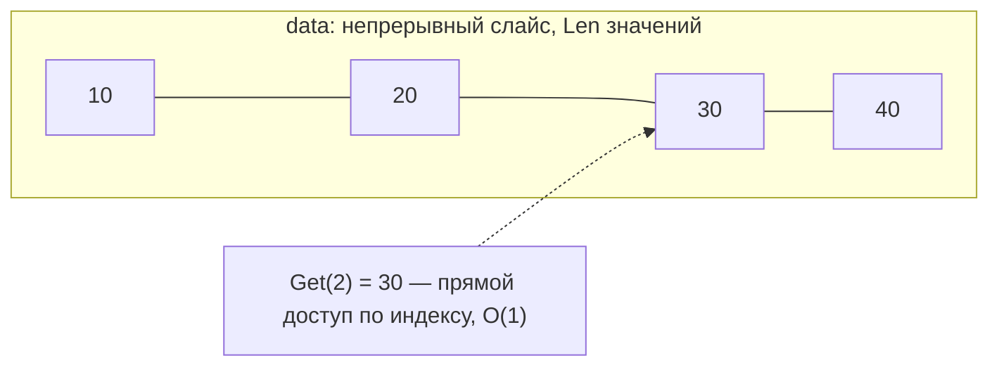
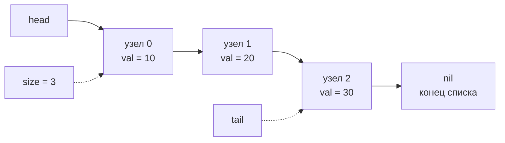
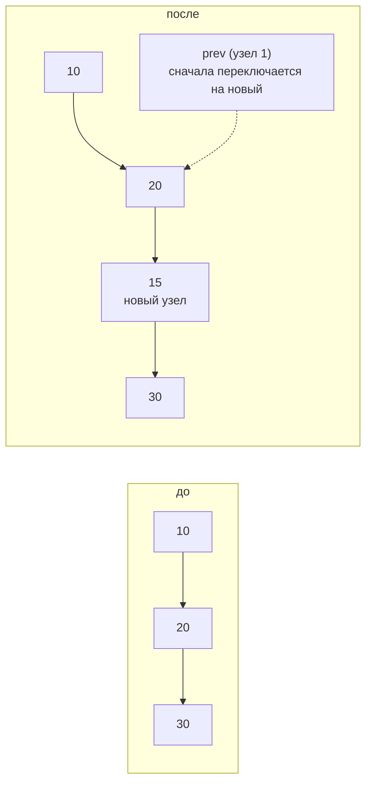
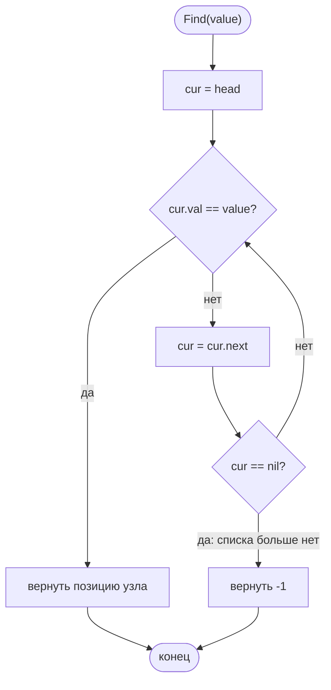

# Списки: список на слайсе и односвязный список

Реализация: `algorithms/structures/` (`List` — на слайсе, `LinkedList` —
на указателях). Оба хранят значения в порядке следования, нумерация позиций
с нуля; ошибочный индекс — `ErrIndexOutOfRange`, а не паника.

## Список на слайсе (`List`)

Растущая структура без фиксированной ёмкости (темы роста и амортизации живут
здесь). Значения идут подряд в непрерывной памяти:

- `Get(i)` — прямой доступ по индексу, **O(1)**.
- `Insert(i, v)` — новый слот добавляется `append`-ом в конец, значения
  правее `i` сдвигаются на одну ячейку вправо, затем `data[i] = v`;
  допустимый индекс — `0..Len` включительно.
- `RemoveAt(i)` — значения правее сдвигаются **влево**, последний слот
  отрезается (`data[:Len-1]`).

Вставка и удаление в середине двигают хвост — **O(n)**. Это главная цена
слайса: непрерывность даёт быстрый доступ по индексу, но любое изменение
середины смещает все значения правее.

## Односвязный список (`LinkedList`)

Память не непрерывна: узел (`node`) хранит значение и указатель `next`.
Структура поддерживает `head`, `tail` и `size` — вставка в хвост O(1)
без обхода:

Пример вставки в середину (`InsertAt(2, 15)` — после узла 1):

Операции и их цена:

| Операция | Цена | Почему |
|----------|------|--------|
| `Prepend`, `Append`, `PopFront` | O(1) | правим только `head`/`tail`; `tail` поддерживается |
| `PopBack` | O(n) | у односвязного узла нет `prev` — путь к предпоследнему узлу идёт обходом от головы |
| `InsertAt`, `RemoveAt` (середина) | O(n) обхода | переход к узлу `i-1` узел за узлом; сама переоценка связи — O(1) |
| `Find(value)` | O(n) | обход от головы (схема ниже) |

**Обход поиска** (`Find`) — операция, где сам обход важен для понимания цены
O(n): идём от головы узел за узлом, пока не встретим значение или не дойдём
до конца.

Сравнение вариантов:

| Свойство | List (слайс) | LinkedList (указатели) |
|----------|--------------|------------------------|
| Доступ по индексу | O(1) | O(n) — обход |
| Вставка/удаление в середине | O(n) — сдвиг хвоста | O(n) — обход до места, переоценка связей O(1) |
| Insert/Pop в хвост | O(1) амортизированная на List | O(1) Append, O(n) PopBack (нет `prev`) |
| Память | непрерывная | узел за узлом + указатели |
