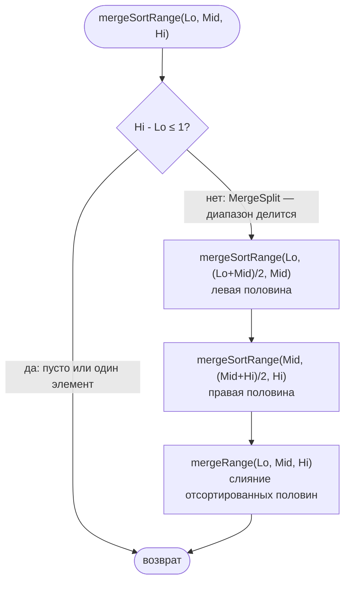
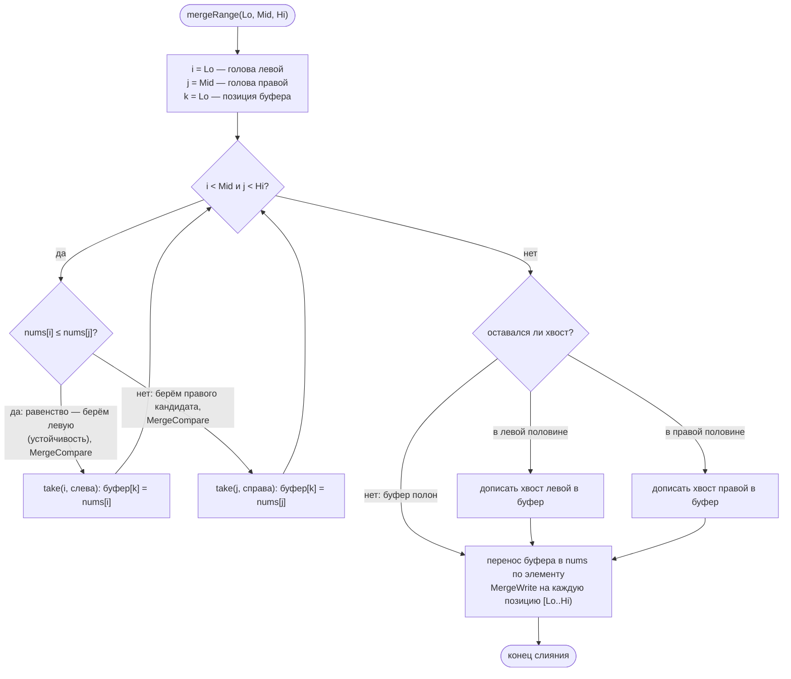
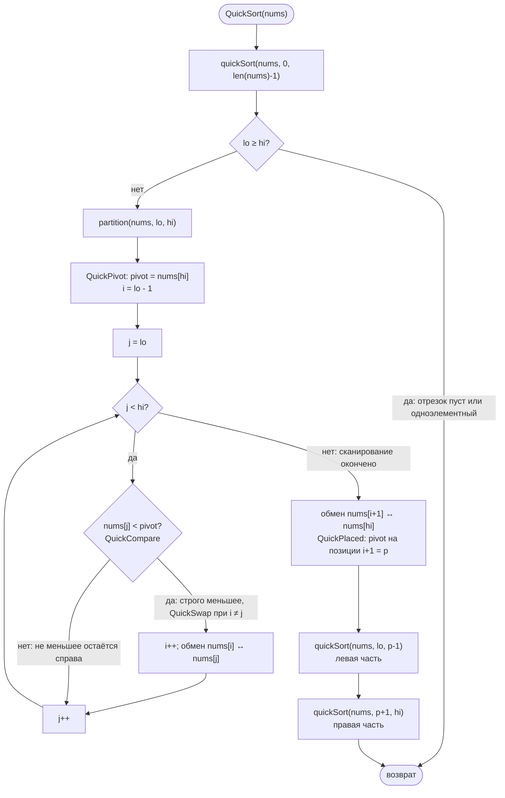

# Merge sort и quicksort

Реализация: `algorithms/sort/` (`MergeSort`, `QuickSort` и их `*WithEmitter`
-варианты). Оба сортируют по возрастанию, на месте с точки зрения вызывающего
кода, для слайса `[]int` — но варианты алгоритмов и цены по памяти разные.

Реализованные варианты: merge sort — **top-down stable** (рекурсивное деление
диапазона пополам, устойчивое слияние через буфер), quicksort — **Lomuto**
(pivot — последний элемент диапазона, строго меньшие значения переносятся
влево).

## Merge sort (top-down, stable)

Рекурсивный спуск: диапазон `[Lo, Hi)` делится пополам границей `Mid`
(левая половина `[Lo, Mid)`, правая `[Mid, Hi)` — верхняя граница
**исключительная**), половины сортируются, затем сливаются через один общий
буфер размера n (память O(n), не зависит от глубины рекурсии). Слияние
устойчивое: при равных головах первым берётся элемент **левой** половины
(`nums[i] <= nums[j]` — нестрогое `<=` как раз ради устойчивости).

### Рекурсивный спуск

### Слияние двух половин

События режима наблюдения: `MergeSplit` (деление диапазона, до спуска
в половины), `MergeCompare` (сравнение голов двух отсортированных половин,
несёт исход `LeftChosen` и позицию `Dest`), `MergeWrite` (видимая запись
значения в массив на шаге переноса буфера, с пометкой `FromLeft`).
На сравнении и копировании в буфер массив ещё не меняется — события
`MergeWrite` размечают переносимые значения, шаги восстановимы.

Свойства: устойчивость, худший/средний/лучший случай O(n log n), память O(n)
(один общий буфер).

## Quicksort (Lomuto, pivot — последний)

Рекурсия по **включительному** диапазону `lo..hi` (в отличие от merge, у
которого верхняя граница исключительная). `partition` берёт pivot `nums[hi]`,
строго меньшие значения через обмен заносятся в растущий блок `[lo..i]`,
затем pivot ставится на финальную позицию `i+1`; рекурсия сортирует
`[lo..p-1]` и `[p+1..hi]`.

Детали реализованного варианта:

- **Строгое** сравнение `nums[j] < pivot`: равные pivot значения остаются
  справа (в блок «строго меньших» они не входят).
- Обмен при `i == j` (строго меньшие стоят подряд) — перестановка позиции
  с собой; он пропускается и не эмитится, тихий результат тот же.
- Вариант **неустойчив**: дальние обмены при partition и финальное размещение
  pivot могут переносить значения через другие равные им значения и менять
  их взаимный порядок.
- Среднее время O(n log n), худшее O(n²) — в частности на уже упорядоченных
  входах при выбранном pivot. Дополнительная память — это глубина стека
  рекурсии: **O(log n) в среднем** и **O(n) в худшем** (при Lomuto с pivot —
  последним элементом худшая глубина рекурсии достигается на уже
  упорядоченных входах, когда partition не делит диапазон пополам).

## Сравнение вариантов

| Свойство | Merge sort | Quicksort |
|----------|------------|-----------|
| Устойчивость | да | нет |
| Среднее время | O(n log n) | O(n log n) |
| Худшее время | O(n log n) | O(n²) |
| Память | O(n) (буфер) | O(log n) в среднем, O(n) в худшем (глубина рекурсии) |
| Границы диапазона | `[Lo, Hi)`, верхняя исключительная | `[lo..hi]`, включительные |
