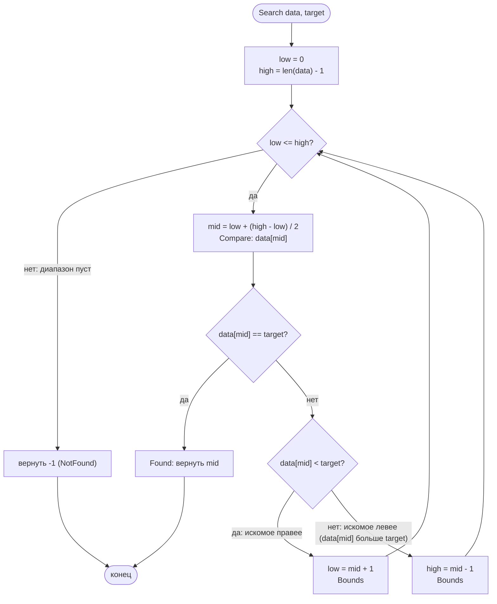

# Бинарный поиск

Реализация: `algorithms/search/` (`Search`, `SearchWithEmitter`).

## Идея

Поиск `target` в **отсортированном по возрастанию** слайсе: сравниваем искомое
со значением в середине диапазона `[low..high]` (обе границы включительные)
и отбрасываем половину оставшихся элементов. Сложность — O(log n).

Средний индекс считается устойчивой формулой `low + (high-low)/2` — без
переполнения `low+high`. Промах — не ошибка, а нормальный результат: `-1`.

## Блок-схема

Точная схема реализованного `SearchWithEmitter` (тихий `Search` — тот же цикл):

## Детали реализации

- **Границы включительные** в обе стороны: пустой диапазон выражается условием
  `low > high` (на финальном промахе границы схлопываются — событие `Bounds`
  может прийти с `low > high`).
- Досрочный выход только на попадании: поиск продолжается, пока хотя бы один
  элемент остаётся в диапазоне.
- События режима наблюдения: `Compare` (сравнение с серединой), `Bounds` (новые
  границы после сравнения), `Found` / `NotFound` (итог). По одному событию
  на каждый шаг — его достаточно, чтобы восстановить кадр визуализации.
- Работает только по отсортированному входу — контракт алгоритма, не проверяется
  рантаймом.
