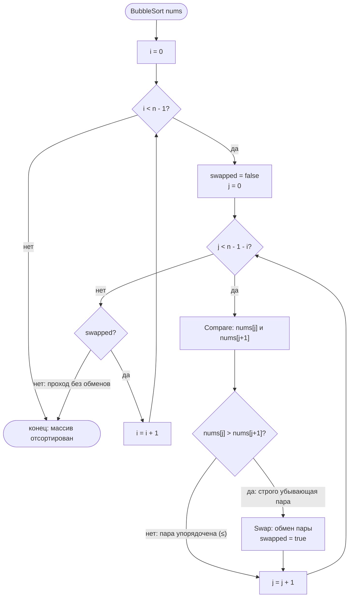
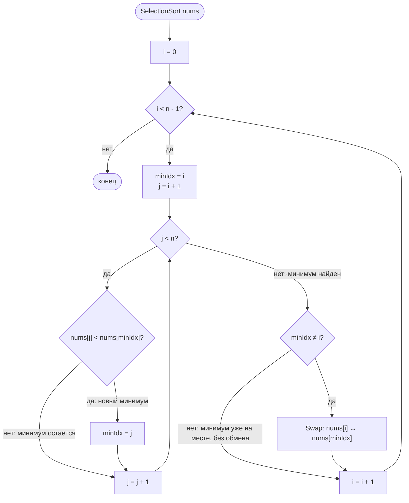
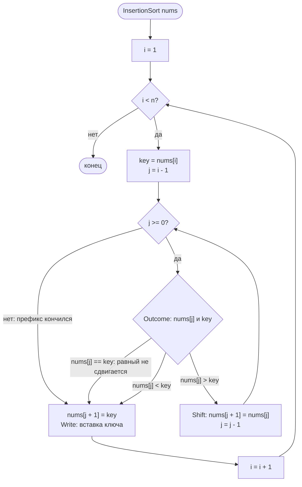

# Простые сортировки: bubble, selection, insertion

Реализация: `algorithms/sort/` (`BubbleSort`, `SelectionSort`, `InsertionSort` и их
`*WithEmitter`-варианты). Все три — по возрастанию, на месте, для слайса `[]int`.

## Bubble sort

Реализованный вариант: проходы слева направо сравнивают соседние элементы;
каждая строго убывающая пара (`nums[j] > nums[j+1]`) меняется местами, и максимум
остатка «всплывает» в конец. Равные соседи (строгое `>`) не обмениваются, поэтому
сортировка **устойчива**. Отсортированные проходы сокращают необработанный
диапазон на `i` справа.

Сложность: худший и средний случай O(n²), лучший — O(n) на уже упорядоченном
входе за счёт досрочного выхода: проход без обменов завершает работу.

## Selection sort

Реализованный вариант — стандартный **неустойчивый**: на каждом проходе ищется
минимум неотсортированной части (кандидаты от `i+1`, минимум смещает строгий
`<` — равные выбор не смещают) и меняется местами с первым элементом части.
Обмен дальними позициями может менять порядок равных — отсюда неустойчивость.

Сложность всегда O(n²) сравнений — даже на упорядоченном входе; обменов не
больше n−1.

## Insertion sort

Реализованный вариант — классический **устойчивый**: ключ `nums[i]` удерживается
вне массива, отсортированный префикс `[0..i-1]` сканируется **справа налево**;
только элементы **строго больше** ключа сдвигаются вправо, равные ключу
не сдвигаются — порядок равных сохраняется. Затем ключ записывается
в освободившуюся позицию («дырку»).

Сложность: худший и средний O(n²), лучший — O(n) на упорядоченном входе
(каждый проход без сдвигов). Обучающее событие `InsertionEqual` (равный не
сдвигается) построено именно на устойчивом варианте — см.
`insertion_events.go`.

## Сравнение вариантов

| Свойство | Bubble | Selection | Insertion |
|----------|--------|-----------|-----------|
| Устойчивость | да | нет | да |
| Лучший случай | O(n) | O(n²) | O(n) |
| На месте | да | да | да |

События всех трёх сортировок (режим наблюдения, ADR-0001) описаны
в комментариях `*_events.go`; здесь приводится только алгоритмическая логика.
