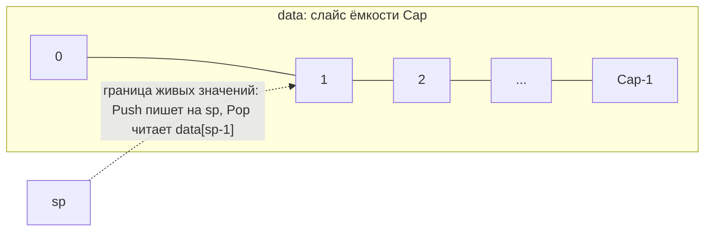
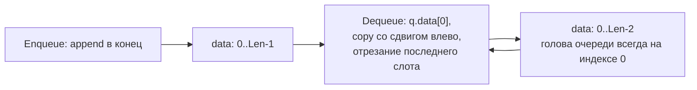

# Стек и очередь

Реализация: `algorithms/structures/` (`Stack`, `Queue`). Обе структуры — на
слайсе, но с разными дисциплинами доступа: стек работает с одним концом,
очередь — с двумя.

## Стек (LIFO)

Стек фиксированной ёмкости на слайсе с указателем `sp` (стековым указателем,
числом элементов): `sp` — позиция следующего пустого слота, одновременно
размер. Данные ниже `sp` — «живой» стек, выше — остаточные значения прошлых
`Pop`.

Пример состояния при 5 значениях в стеке (sp = 5):

| индекс | 0 | 1 | 2 | 3 | 4 |
|--------|---|---|---|---|---|
| данные | 10 | 20 | 30 | 40 | 50 |
|        | внизу | | | | ∧ `sp` — вершина |

Операции: `Push` пишет на `sp` и сдвигает его вправо (переполнение —
`ErrStackOverflow` при `sp == Cap`), `Pop` читает `data[sp-1]` и сдвигает
влево (пустой стек — `ErrStackUnderflow`), `Peek` читает без снятия. Все
операции O(1) — обхода нет. Отрицательная ёмкость при создании — ошибка
`ErrStackNegativeCapacity`, а не паника.

## Очередь (FIFO)

Очередь фиксированной ёмкости `max` на слайсе: значения добавляются
в конец (`append`), снимаются спереди (`Dequeue`) — со сдвигом оставшихся
элементов влево (copy). Колец (ring buffer) нет: реализация простая учебная,
цена `Dequeue` — O(n) по числу живых элементов.

| индекс | 0 | 1 | 2 |
|--------|---|---|---|
| данные | 10 | 20 | 30 |
|        | ∧ голова — выходит первой | | ∧ хвост — сюда Enqueue |

Операции: `Enqueue` (полная очередь — `ErrQueueFull`), `Dequeue` (пустая —
`ErrQueueEmpty`), `Peek` (голова без снятия), `Clear`. Отрицательная ёмкость
при создании — `ErrQueueNegativeCapacity`. Отсутствие значения и переполнение
— ошибки API, которые вызывающий код решает показать сам.

## Сравнение

| Свойство | Стек | Очередь |
|----------|------|---------|
| Дисциплина | LIFO — последний пришёл, первый уходит | FIFO — первый пришёл, первый уходит |
| Концы | один (`sp`) | два (голова — Dequeue, хвост — Enqueue) |
| Цена добавления (Push / Enqueue) | O(1) | O(1) |
| Цена снятия (Pop / Dequeue) | O(1) | O(n) на `Dequeue` — сдвиг влево |
| Ёмкость | фиксированная | фиксированная (`max`) |
