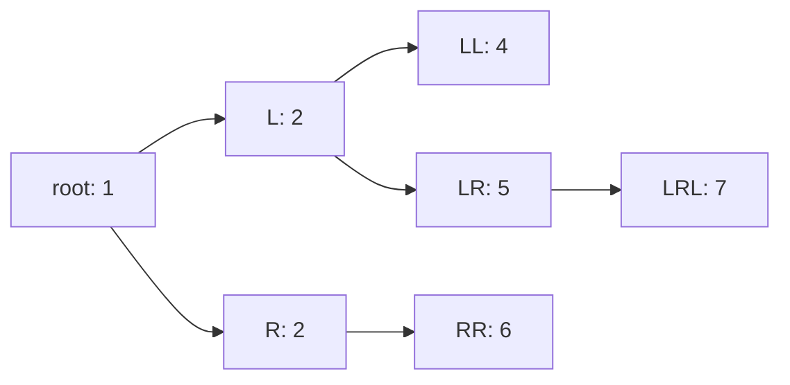

# Обходы бинарного дерева: in-order, pre-order, post-order и по уровням

Реализация: `algorithms/trees/`. Общая модель бинарного дерева, три обхода
в глубину — рекурсивно — и обход по уровням через FIFO-очередь; все — в
quiet mode и в режиме наблюдения (ADR-0001).

## Модель дерева

`Node` — узел с целочисленным значением и двумя потомками — `Left` и `Right`
(указателями). Отсутствующий потомок — `nil`, им задаётся и пустое дерево
(корень `nil`). Модель **не предполагает свойств BST**: форма произвольная,
значения могут повторяться. Поэтому идентичность узла не выводится из
значения: каждый узел задаётся **путём от корня** — строкой из букв `L`
(левый потомок) и `R` (правый). Корень — пустой путь, его идентификатор —
`root` (функция `NodeID`).

Здесь два узла со значением 2 — это `L` и `R`: значения равные, узлы разные.

## Три порядка обхода

Рекурсия одна и та же — «обойди левое поддерево, обойди правое»; порядки
отличаются тем, **когда** «посещается» сам узел:

| Порядок | Рекурсия (по порядку шагов) |
|---------|------------------------------|
| In-order | левое поддерево → узел → правое поддерево |
| Pre-order | узел → левое поддерево → правое поддерево |
| Post-order | левое поддерево → правое поддерево → узел |

На дереве со схемой выше посещения идут так:

| Порядок | Последовательность (узел: значение) |
|---------|--------------------------------------|
| In-order | `LL`:4, `L`:2, `LRL`:7, `LR`:5, `root`:1, `R`:2, `RR`:6 |
| Pre-order | `root`:1, `L`:2, `LL`:4, `LR`:5, `LRL`:7, `R`:2, `RR`:6 |
| Post-order | `LL`:4, `LRL`:7, `LR`:5, `L`:2, `RR`:6, `R`:2, `root`:1 |

Заметьте: in-order и post-order похожи по значениям лишь случайно — порядок
относится к узлам (путям), а не к значениям. Пустое дерево через любой
порядок даёт пустой результат: рекурсия тут же упирается в `nil`.

Сложность: время O(n) — каждый узел посетили один раз; память O(h) —
стек рекурсивных вызовов глубиной h (высота дерева), худший случай —
перекошенное дерево, h = n.

## Обход по уровням (level-order)

Глубинные обходы отличаются «когда» посещается узел; обход по уровням
меняет и сам маршрут: узлы посещаются **уровень за уровнем** — сверху
вниз, слева направо внутри уровня. Такой порядок задаёт FIFO-очередь:

- в начале в очереди только корень;
- шаг: узел снимается **с головы** очереди и посещается; его существующие
  потомки становятся **в конец** очереди — сначала левый, потом правый;
- уровни идут по кругу: пока в очереди все узлы текущего уровня, их
  потомки накапливаются в конце — следующий уровень стартует первым
  ребёнком.

На том же дереве level-order посещает: `root`:1, `L`:2, `R`:2, `LL`:4,
`LR`:5, `RR`:6, `LRL`:7 — как in/pre/post-order, порядок относится к
узлам (путям), не к значениям. Пустое дерево даёт пустой результат.

Сложность: время O(n) — каждый узел встал в очередь и вышел из неё один
раз. По числу элементов (соглашение в README) память под очередь — O(w):
живых записей — не больше пары соседних уровней (w — ширина дерева,
худший случай ~n/2 у полного дерева; у перекошенного дерева в очереди
всегда одна запись). Оценка относится к очереди тихого LevelOrder и не
учитывает возвращённый результат — слайс значений занимает память сверх
O(w). Сверх той же оговорки — payload пути: каждая live-запись хранит
строку-путь от корня длиной до глубины h, поэтому байтовая память
очереди до O(w·h) и от O(w) не сводится: у перекошенного дерева (w = 1,
h = O(n)) единственная запись несёт путь длиной до n символов.

Оговорка к emitter-режиму: накладные расходы там не те же, что у тихого
обхода. Каждый `LevelOrderVisit` несёт полный снимок очереди, поэтому
лишняя работа на шаг и объём снимков растут пропорционально сумме
размеров очереди по всем шагам.

## Quiet mode и события

Quiet-версии (`InOrder`, `PreOrder`, `PostOrder`, `LevelOrder`) — обычные
функции: принимают корень, возвращают значения в порядке посещения.

Режим наблюдения — `*WithEmitter` с тем же контрактом (см. ADR-0001):

- глубинные обходы перед посещением узла эмитируют `DFSVisit{Path, Value}`;
- level-order эмитирует на каждый посещённый узел
  `LevelOrderVisit{Path, Value, Queue}` — с **состоянием FIFO-очереди
  сразу после шага**: посещённый узел уже снят с головы, его потомки уже
  в конце; `Queue` — идентификаторы узлов (пути) от головы к хвосту,
  свежая копия, не связанная с живой очередью обхода.

По событиям последовательность посещений восстанавливается по путям:
повторяющиеся значения остаются различимыми, `NodeID(path)` даёт
стабильный идентификатор узла, не зависящий от значения (его же
использует снимок kind="tree" визуализатора).

## Визуализация

Серверный маршрут `/api/run/tree-traversal` принимает URL-кодированные
`tree` (вложенный JSON: `value`, `left`, `right`; верхний `null` — пустое
дерево) и `order` (in-order / pre-order / post-order / level-order).
Дерево больше 100 узлов и невалидный JSON отвергаются до начала SSE.

Кадры kind="tree" самодостаточны (ADR-0002): полная топология узлов
в каждом кадре, активный узел, посещённые с номерами позиций и пояснение
на русском. Первый кадр — исходный снимок без посещений, далее по кадру
на каждое событие посещения. У level-order кадр дополнительно несёт
`queue` — FIFO-очередь с идентификаторами узлов от головы к хвосту
(стартовый кадр: в очереди уже ждёт корень; в финальном кадре очередь
опустела); у глубинных порядков `queue` — пустой массив.
