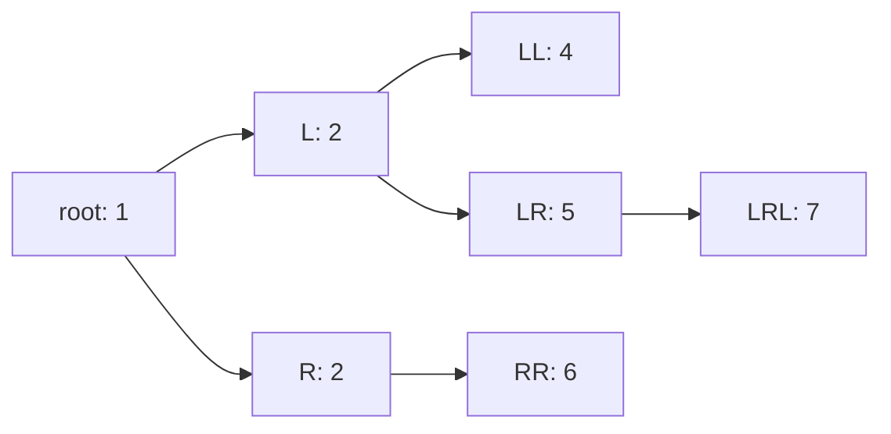

# Обходы бинарного дерева: in-order, pre-order, post-order

Реализация: `algorithms/trees/`. Общая модель бинарного дерева и три обхода
в глубину — рекурсивно, в quiet mode и в режиме наблюдения (ADR-0001).

## Модель дерева

`Node` — узел с целочисленным значением и двумя потомками — `Left` и `Right`
(указателями). Отсутствующий потомок — `nil`, им задаётся и пустое дерево
(корень `nil`). Модель **не предполагает свойств BST**: форма произвольная,
значения могут повторяться. Поэтому идентичность узла не выводится из
значения: каждый узел задаётся **путём от корня** — строкой из букв `L`
(левый потомок) и `R` (правый). Корень — пустой путь, его идентификатор —
`root` (функция `NodeID`).

Здесь два узла со значением 2 — это `L` и `R`: значения равные, узлы разные.

## Три порядка обхода

Рекурсия одна и та же — «обойди левое поддерево, обойди правое»; порядки
отличаются тем, **когда** «посещается» сам узел:

| Порядок | Рекурсия (по порядку шагов) |
|---------|------------------------------|
| In-order | левое поддерево → узел → правое поддерево |
| Pre-order | узел → левое поддерево → правое поддерево |
| Post-order | левое поддерево → правое поддерево → узел |

На дереве со схемой выше посещения идут так:

| Порядок | Последовательность (узел: значение) |
|---------|--------------------------------------|
| In-order | `LL`:4, `L`:2, `LRL`:7, `LR`:5, `root`:1, `R`:2, `RR`:6 |
| Pre-order | `root`:1, `L`:2, `LL`:4, `LR`:5, `LRL`:7, `R`:2, `RR`:6 |
| Post-order | `LL`:4, `LRL`:7, `LR`:5, `L`:2, `RR`:6, `R`:2, `root`:1 |

Заметьте: in-order и post-order похожи по значениям лишь случайно — порядок
относится к узлам (путям), а не к значениям. Пустое дерево через любой
порядок даёт пустой результат: рекурсия тут же упирается в `nil`.

Сложность: время O(n) — каждый узел посетили один раз; память O(h) —
стек рекурсивных вызовов глубиной h (высота дерева), худший случай —
перекошенное дерево, h = n.

## Quiet mode и события

Quiet-версии (`InOrder`, `PreOrder`, `PostOrder`) — обычные функции:
принимают корень, возвращают значения в порядке посещения.

Режим наблюдения — `*WithEmitter` с тем же контрактом (см. ADR-0001):
перед посещением узла эмитируется событие `DFSVisit{Path, Value}`.
По событиям последовательность посещений восстанавливается по путям:
повторяющиеся значения остаются различимыми, `NodeID(path)` даёт
стабильный идентификатор узла, не зависящий от значения (его же
использует снимок kind="tree" визуализатора).

## Визуализация

Серверный маршрут `/api/run/tree-traversal` принимает URL-кодированные
`tree` (вложенный JSON: `value`, `left`, `right`; верхний `null` — пустое
дерево) и `order` (in-order / pre-order / post-order). Дерево больше
100 узлов и невалидный JSON отвергаются до начала SSE.

Кадры kind="tree" самодостаточны (ADR-0002): полная топология узлов
в каждом кадре, активный узел, посещённые с номерами позиций и пояснение
на русском. Первый кадр — исходный снимок без посещений, далее по кадру
на каждое событие посещения.
