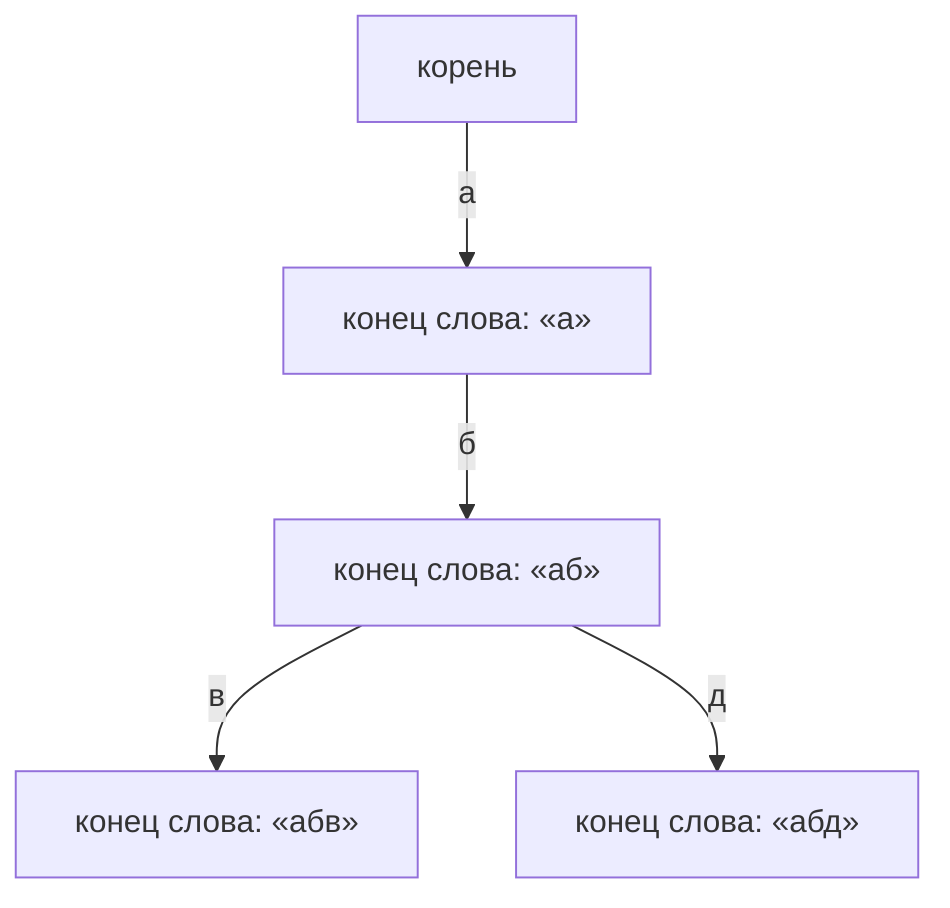
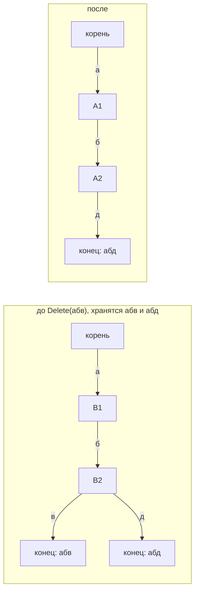

# Trie: вставка, поиск, префиксы и удаление

Реализация: `algorithms/trees/` (`Trie`). Классическое **несжатое**
префиксное дерево для Unicode-слов: путь от корня по rune-меткам рёбер
кодирует слово, узел с отметкой конца слова — само сохранённое слово.
Общие префиксы слов разделяются и переиспользуются — именно это видно
на словах с общим началом.

## Представление

Каждый узел (`NodeTrie`) держит переходы по рунам в map и флаг конца слова.
Переходы идут по **отдельным rune** — одному Unicode scalar value: символ
вне базовой многоязычной плоскости (`😀`, U+1F600) — одна руна, а не байты
и не UTF-16-половины. Сравнение rune точное: без нормализации Unicode и без
смены регистра, поэтому «Apple» и «apple», а также NFC- и NFD-формы одного
символа — разные слова. Терминальный узел не обязан быть листом: слово
«аб» может лежать на пути к «абв».

Здесь путь к «абв» и «абд» разделяет общий префикс «аб», а слова «аб» и «а»
хранятся отметками конца слова на промежуточных узлах, не на листьях.

## Операции

Все операции — спуск от корня по рунам слова/префикса, поэтому цена каждой —
O(m), где m — длина слова/префикса, независимо от числа сохранённых слов.

| Операция | Как работает | Цена |
|----------|--------------|------|
| `Insert(word)` | спуск по рунам с созданием отсутствующих узлов; на последней руне ставится флаг конца слова (если его ещё не было) и растёт `Len` | O(m) |
| `Search(word)` | спуск по рунам; true — путь есть и конечный узел отмечен концом слова; отсутствие руны или отсутствие отметки — промах | O(m) |
| `StartsWith(prefix)` | тот же спуск по рунам; true — путь префикса существует, отметка конца слова не требуется; пустой префикс соответствует корню — всегда true | O(m) |
| `Delete(word)` | спуск по рунам, снятие флага конца слова и pruning ставших ненужными узлов | O(m) |
| `Len()` | инкрементный счётчик разных слов | O(1) |

## Границы слов и ошибки

- Пустое слово не хранится: `Insert("")` и `Delete("")` — ошибки
  (`ErrInsertEmptyWord`, `ErrDeleteEmptyWord`); `Search("")` — всегда false;
  `StartsWith("")` — всегда true, даже в пустом Trie.
- Невалидный UTF-8 (например, `string([]byte{0xFF})`) отклоняется каждой
  операцией различимой ошибкой `ErrInvalidUTF8` — это не промах Search и не
  «найденный префикс» StartsWith; Trie и `Len` при этом не меняются.
- Повторная вставка идемпотентна: дерево и `Len` не меняются, результат
  сообщает, что слово не добавлено. Промах `Delete` — не ошибка: дерево не
  меняется, результат сообщает, что слово не найдено и не удалено.

## Pruning при удалении

Удаление снимает флаг конца слова у удаляемого слова, затем снизу вверх
стирает только узлы, которые больше не ведут ни к какому концу слова:
на первом узле с отметкой конца слова или с потомками остановка. Поэтому
ветвления и сохранённые слова-префиксы остаются: при словах «абв» и «абд»
удаление «абв» срезает только узел «в» — ветвление на «б» и слово «абд»
живы; а при словах «аб» и «абв» удаление «аб» не срезает ничего — узел «б»
всё ещё ведёт к «абв».

## События (режим наблюдения)

Тихий режим и режим наблюдения (`*WithEmitter`-методы, ADR-0001) дают одну
семантику: один и тот же обход, только шаги операции стреляют событиями
`TrieEvent`. Каждое rune-обращение — не более одного события посещения/
проверки `TrieVisit` с руной и состоянием ребра (`EdgeReused` — ребро
существовало, `EdgeCreated` — вставка создала ребро, `EdgeMissing` — попытка
поиска/проверки префикса/удаления пройти отсутствующее ребро, узел не
создаётся и обход прекращается). На последней руне вставки/удаления то же
событие несёт итоговое состояние флага конца слова — но только когда оно
меняется (`EndFlag`, отдельного события отметки нет). Каждый срезанный при
pruning узел даёт одно событие `TriePrune` (руна ребра и глубина), а каждая
валидная операция — ровно одно событие результата: `TrieInserted` /
`TrieAlreadyExisted`, `TrieFound` / `TrieNotFound`, `TriePrefixFound` /
`TriePrefixNotFound`, `TrieDeleted` / `TrieNotDeleted`. Ошибочные вызовы
(пустое слово, невалидный UTF-8) возвращают ошибку до любых событий.
